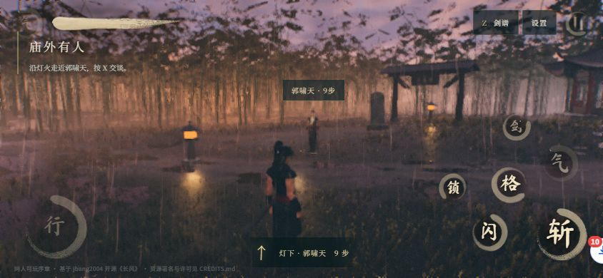

# 七星剑境 · Seven Stars Sword Realms

基于 [jbang2004/long-wind](https://github.com/jbang2004/long-wind) 改编的浏览器三维武侠动作游戏。扮演丘处机，在风雨牛家村完成一段有分支选择的同人序章，或进入草原、竹林、边城演武。

**[在线试玩](https://play1.heyluckyme.com/)** · **[手机流畅触控版](https://play1.heyluckyme.com/?q=low&touch=1)** · [改编说明](ADAPTATION.md) · [资源署名](CREDITS.md)



## 玩法

- 精准招架、极限闪避与制敌积攒七星剑意；三星强化剑境，七星触发北斗合一。
- 守 · 回风、破 · 惊雷、御 · 流云三条剑路；各施一次强化剑境，第三路触发三路共鸣。
- 救人或追敌的选择、三段遭遇、试招目标、战斗小结与自由探索。
- Three.js / WebGL 2 三维场景、程序化天气和 WebAudio 声音，无需后端。

## 本地运行

需要 Node.js 22.12+ 和支持 WebGL 2 的现代浏览器。

```sh
git clone https://github.com/papacs/seven-stars-sword-realms.git
cd seven-stars-sword-realms
npm ci --ignore-scripts
npm run dev
```

访问 http://127.0.0.1:5173/ 。已有游戏资源随仓库保留，无需运行素材抓取脚本。

```sh
npm test          # 战斗、剧情、剑意与音频生命周期测试
npm run build     # 生成 dist/
npm run preview   # 通过 HTTP 预览生产构建
```

不能直接双击 `dist/index.html` 运行。`private: true` 仅用于防止误发布 npm 包，GitHub 仓库是公开的。

## 操作与手机

| 操作 | 按键 |
| --- | --- |
| 行走 / 连击 / 重剑 | WASD / J 或左键 / C |
| 招架 / 闪避 / 锁定 | K 或右键 / Space / Q |
| 切换剑路 / 满气剑境 | 1、2、3 / E |
| 交谈察看 / 剑谱 / 视角归位 | X / Z / B |
| 静音 / 暂停 | M / Esc |

手机建议横屏，使用左侧虚拟摇杆和右侧招式按钮。剑境选择收进右上角「设置 → 剑境选择」，选择后返回游戏，真气满时点「气」释放。声音调节在设置的声音页签中。实际流畅度取决于设备性能。

`?q=low` 使用流畅画质；`?touch=1` 强制显示触控按钮；`?level=steppe|bamboo|town` 进入演武地图。

## 部署

本项目为静态站点，构建输出目录是 `dist`，可部署到 Cloudflare Pages 等静态托管服务。

```sh
npm run build
npx wrangler pages deploy dist --project-name <你的 Pages 项目名> --branch main
```

当前演示由 Cloudflare Pages 托管。仓库的 CI 只运行测试和构建；发布到自己的账户时自行配置域名与凭据，不要提交令牌或 `.env`。

## 开源与署名

源码采用 [MIT License](LICENSE)。保留上游作者 jbang2004 的版权及许可声明；本项目的剧情、七星剑意、剑路、设置页与触控适配等改编也按 MIT 提供。

**模型、动作、字体等第三方资源各自沿用原许可，不能统一视为 MIT 素材。** 请先阅读 [CREDITS.md](CREDITS.md)：Tripo 角色与 Mixamo 动作不是可单独提取、转售或再分发的 MIT 素材。Poly Haven 资源为 CC0，字体遵循各自字体许可。

本作是非官方同人演绎，不代表相关作品权利人的授权或背书。完整改编范围见 [ADAPTATION.md](ADAPTATION.md)，贡献方式见 [CONTRIBUTING.md](CONTRIBUTING.md)。
